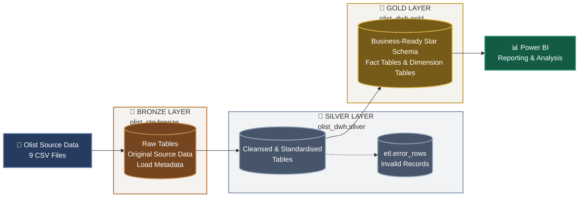
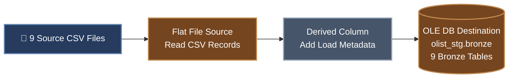
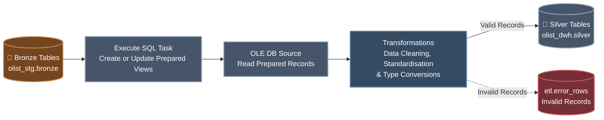

  

### 📌 Project Overview

In this project, I take on the role of a Data Engineer at Olist, a Brazilian e-commerce marketplace. My assignment is to design and build an end-to-end data warehouse that consolidates the company's e-commerce data into a centralised environment.

The project uses nine raw CSV datasets covering different areas of the business, including customers, sellers, products, orders, payments, order items, customer reviews, geographical locations and product category translations.

### 🏢 Business Context

Olist is a Brazilian online marketplace that connects small businesses with customers. Sellers list their products on the platform, customers place orders, and sellers fulfil those orders through delivery partners.

This business model is easy to relate to in South Africa. Platforms such as Takealot operate in a similar e-commerce environment where customers place orders, businesses fulfil them, deliveries take place and customers share feedback about their experiences.

Every transaction generates valuable information about customer behaviour, seller performance, product sales, payments, delivery operations and customer satisfaction.

This information is important to the business because it helps management understand how different areas of the marketplace are performing. Bringing these different sources of information together creates an opportunity to generate meaningful business insights and support better decision-making.

### ⚠️ Business Problem

Olist sits on a large amount of transactional data generated between 2016 and 2018. However, turning this data into meaningful business information presents several challenges.

Business information is spread across different datasets, making it difficult to get a complete view of business performance. Data quality issues, inconsistent formats and the lack of a centralised analytical environment further complicate reporting and analysis.

As a result, management faces challenges in understanding revenue, customer behaviour, seller performance, product sales, delivery efficiency and customer satisfaction.

### 🎯 Project Requirements & Technical Approach

As the Data Engineer assigned to this project, I received technical guidance from my Senior Data Engineer outlining the architecture, technologies and requirements for delivering the solution.

The project follows the **Medallion Architecture (Bronze → Silver → Gold)** using SQL Server, SQL Server Management Studio (SSMS), SQL Server Integration Services (SSIS) and Power BI.

- **Infrastructure:** Establish databases, schemas, tables and ETL logging structures.
- **Bronze Layer – Raw:** Ingest the nine CSV datasets into SQL Server while preserving original source values and capturing ingestion metadata, batch information and load statistics.
- **Silver Layer – Cleansed:** Apply data type conversions, standardisation, deduplication, aggregations and data quality handling to produce reliable datasets.
- **Gold Layer – Business Ready:** Build a Star Schema with fact and dimension tables, surrogate keys and customer history tracking using Slowly Changing Dimension (SCD Type 2).
- **SSIS Orchestration:** Develop a master package to coordinate ETL execution, manage configurations and maintain batch logs, load audits and error records.
- **Data Quality & Analytics:** Implement SQL validation tests, develop business analytics queries using the Gold layer and build a Power BI dashboard to communicate business insights.

The objective is to deliver a reliable, auditable and business-ready data warehouse that transforms raw e-commerce data into meaningful business insights.

**📖 Detailed Technical Requirements:** [View Original Project Brief](https://github.com/KetroSithole/brightlearn_olist_dwh_2026/tree/main)

### 🧩 Architecture Overview

### 🥉 Bronze Data Ingestion (`01_bronze_load.dtsx`)

### 🥈 Silver Data Transformation (`02_silver_transform.dtsx`)

