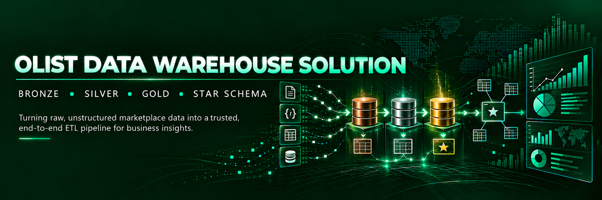

  

### 📌 Project Overview

In this project, I take on the role of a Data Engineer at Olist, a Brazilian e-commerce marketplace. My goal is to build an end-to-end data warehouse using SQL Server, SSIS and the Medallion Architecture (Bronze → Silver → Gold).

The project starts with nine raw CSV files containing e-commerce data. I will ingest, clean and transform the data before organising it into a Star Schema that can support reliable reporting and business analysis.

### 🏢 Business Context

Olist is a Brazilian online marketplace that connects small businesses with customers. Sellers list their products on the platform, customers place orders, and sellers fulfil those orders through delivery partners.

This business model is easy to relate to in South Africa. Platforms such as Takealot and Mr D operate in familiar e-commerce spaces where customers place orders, businesses fulfil them, deliveries take place and customers share feedback about their experiences.

Behind every order is valuable data about customers, sellers, products, payments, deliveries and customer satisfaction. Bringing that information together is where data engineering becomes important.

### ⚠️ Business Problem

Olist has nine raw CSV extracts covering approximately 100,000 orders between 2016 and 2018, but no centralised data warehouse.

This creates a challenge: information is scattered across different datasets, making it difficult for the business to get a consistent view of revenue, delivery performance and customer satisfaction.

My task is to solve this problem by building a reliable data warehouse that brings the information together, improves data quality and creates a trusted foundation for reporting and business decisions.
