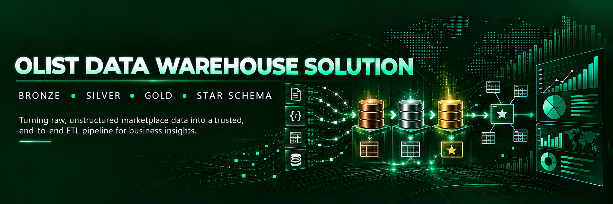
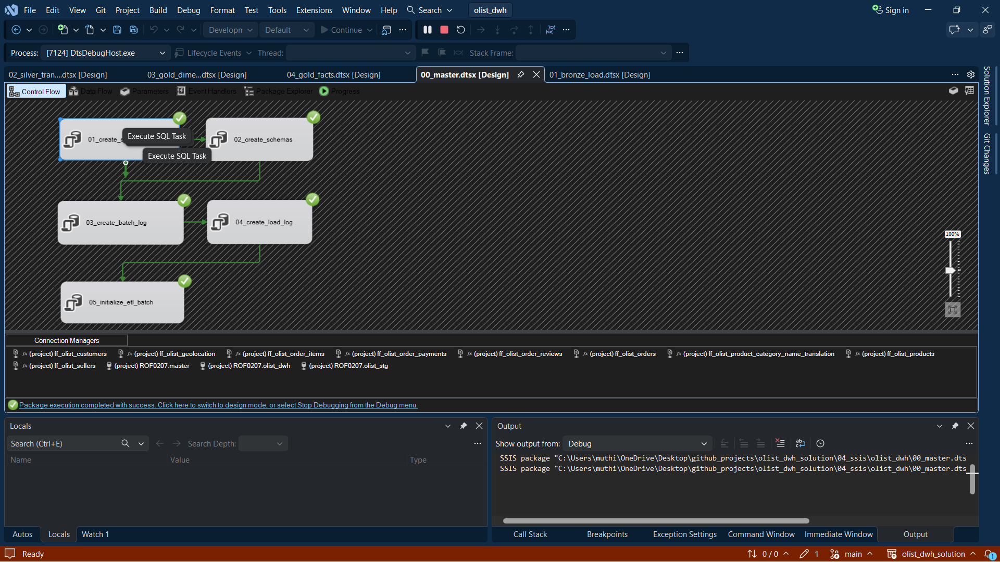

  

## 📌 1. Project Overview

In this project, I take on the role of a Data Engineer at Olist, a Brazilian e-commerce marketplace. My assignment is to design and build an end-to-end data warehouse that brings the company's e-commerce data together into a centralised environment.

The project uses nine raw CSV datasets covering different areas of the business, including customers, sellers, products, orders, payments, order items, customer reviews, geographical locations and product category translations.

Using SQL Server and SQL Server Integration Services (SSIS), I build an ETL pipeline based on the Medallion Architecture (Bronze → Silver → Gold). The process involves loading the raw datasets into SQL Server, cleaning and transforming the data, and preparing it for analytical purposes through a Star Schema.

The overall goal is to create a reliable data warehouse that brings the different areas of the business together, improves data quality and makes it easier to analyse business performance and generate meaningful insights.

## 🏢 2. Business Context

Olist is a Brazilian online marketplace that connects small businesses with customers. Sellers list their products on the platform, customers place orders, and sellers fulfil those orders through delivery partners.

This business model is easy to relate to in South Africa. Platforms such as Takealot operate in a similar e-commerce environment where customers place orders, businesses fulfil them, deliveries take place and customers share feedback about their experiences.

Every transaction within this marketplace generates valuable information about customers, sellers, products, orders, payments, deliveries and customer satisfaction.

This information is important because it helps the business understand how different areas of its operations are performing. For example, management needs to understand which products generate the most revenue, how sellers are performing, whether orders are being delivered on time and how customers feel about their shopping experiences.

Bringing these different sources of information together creates an opportunity to get a better understanding of the business as a whole and support informed decision-making.

## ⚠️ 3. Business Problem

Olist generates a large amount of transactional data through its e-commerce operations between 2016 and 2018. However, turning this information into meaningful business insights presents several challenges.

The information is spread across nine different datasets, with each dataset representing a particular area of the business. Analysing these datasets independently makes it difficult to get a complete picture of what is happening across the marketplace.

There are also data quality challenges, including inconsistent formats, duplicate records and differences in how information is stored. These issues make it difficult to bring the data together and use it confidently for reporting and analysis.

As a result, management faces challenges in understanding important areas of business performance, such as:

- Revenue and overall sales performance.
- Customer purchasing behaviour and repeat purchases.
- Product and seller performance.
- Payment trends and customer payment preferences.
- Delivery performance and late deliveries.
- Customer satisfaction and product reviews.

The challenge, therefore, is to bring these different datasets together, address the data quality issues and develop a centralised data warehouse that can provide reliable information for business analysis and reporting.

## 🏗️ 4. Solution Architecture

My solution uses a Master Package to manage and control the execution of the entire Olist Data Warehouse ETL process. It starts by preparing the databases and schemas, setting up the audit tables and generating a batch ID to keep track of each ETL execution.

Once these steps are completed, the Master Package will execute the individual SSIS packages in sequence: Bronze, Silver, Gold Dimensions and finally Gold Facts. Each layer has its own package, which means I can run and test each stage independently while still having the ability to execute the entire ETL process from one central point.

The diagram below illustrates the overall ETL architecture and how data moves through the different layers.

```mermaid
flowchart LR

    SRC[("OLIST SOURCE DATA<br/>9 CSV DATASETS")]

    MASTER["00_master.dtsx<br/>MASTER PACKAGE<br/>ETL ORCHESTRATION"]

    subgraph BRONZE["01 | BRONZE LAYER"]
        direction TB
        BP["01_bronze_load.dtsx<br/>BRONZE LOAD"]
        BDB[("olist_stg<br/>RAW DATA TABLES")]
        BP --> BDB
    end

    subgraph SILVER["02 | SILVER LAYER"]
        direction TB
        SP["02_silver_transform.dtsx<br/>SILVER TRANSFORMATION"]
        SDB[("olist_dwh<br/>CLEANSED DATA TABLES")]
        SP --> SDB
    end

    subgraph GOLD["03 | GOLD LAYER"]
        direction TB
        DP["03_gold_dimensions.dtsx<br/>DIMENSION PACKAGE"]
        FP["04_gold_facts.dtsx<br/>FACT PACKAGE"]
        GDB[("olist_dwh<br/>GOLD STAR SCHEMA")]
        DP --> FP --> GDB
    end

    AUDIT[("ETL AUDIT TABLES<br/>BATCH LOG | LOAD LOG | ERROR ROWS")]

    END["ETL EXECUTION<br/>SUCCESS / FAILED"]

    SRC --> BP
    BDB --> SP
    SDB --> DP
    GDB --> END

    MASTER -.-> BP
    MASTER -.-> SP
    MASTER -.-> DP
    MASTER -.-> FP

    MASTER -.-> AUDIT
    BP -.-> AUDIT
    SP -.-> AUDIT
    FP -.-> AUDIT

    classDef master fill:#244638,stroke:#142D24,color:#FFFFFF,stroke-width:3px;
    classDef bronze fill:#B18459,stroke:#805B38,color:#FFFFFF,stroke-width:2px;
    classDef bronzeDB fill:#795638,stroke:#563B26,color:#FFFFFF,stroke-width:2px;
    classDef silver fill:#C2C7CC,stroke:#858D95,color:#263238,stroke-width:2px;
    classDef silverDB fill:#7D8993,stroke:#59656E,color:#FFFFFF,stroke-width:2px;
    classDef gold fill:#C6A85F,stroke:#947B3D,color:#302716,stroke-width:2px;
    classDef goldDB fill:#92763C,stroke:#675126,color:#FFFFFF,stroke-width:2px;
    classDef source fill:#344D40,stroke:#1D362A,color:#FFFFFF,stroke-width:2px;
    classDef audit fill:#536D60,stroke:#304A3B,color:#FFFFFF,stroke-width:2px;
    classDef finish fill:#244638,stroke:#142D24,color:#FFFFFF,stroke-width:2px;

    class MASTER master;
    class BP bronze;
    class BDB bronzeDB;
    class SP silver;
    class SDB silverDB;
    class DP,FP gold;
    class GDB goldDB;
    class SRC source;
    class AUDIT audit;
    class END finish;

    style BRONZE fill:#F4EDE4,stroke:#B18459,stroke-width:2px,color:#694A2D
    style SILVER fill:#EEF0F2,stroke:#A6ADB4,stroke-width:2px,color:#45515B
    style GOLD fill:#F5F0E1,stroke:#C6A85F,stroke-width:2px,color:#75602D
```

### 📸 Master Package Execution Evidence

The screenshot below shows the successful execution of my Master Package, including database preparation, schema creation and ETL batch initialisation.

